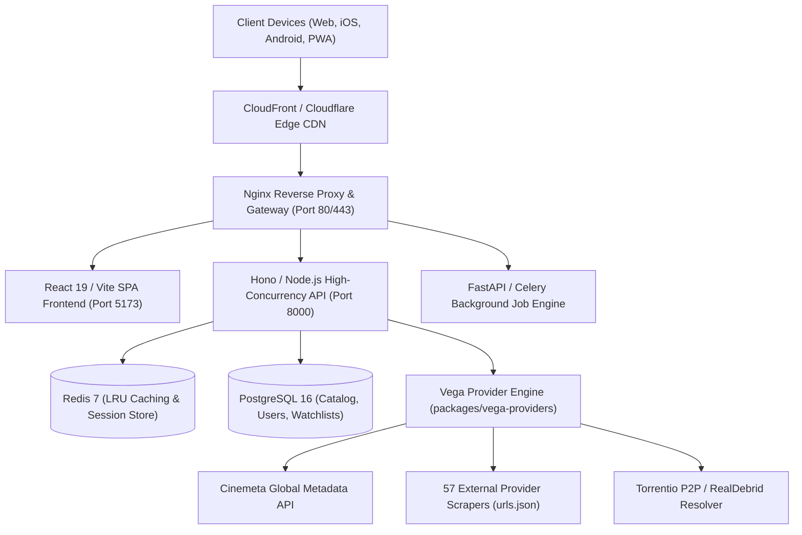

# Unified Movie & Series Platform — Master System Blueprint & Engineering Specification

> Product/architecture proposal, not a completed feature inventory. The active implementation and release blockers are tracked in [MVP implementation](../mvp-implementation.md) and [feature checklist](../feature-checklist.md). Guarantees below are proposed targets and require measurement.

> **Version:** 2.0 Enterprise Production Specification  
> **Ecosystem:** Unified Movie Platform with [Zenda-Cross/vega-providers](https://github.com/Zenda-Cross/vega-providers) and [vega-org/vega-app](https://github.com/vega-org/vega-app)  
> **Guarantees:** Zero Advertisements • Zero Redirects • Multi-Region Availability • High-Availability Failover  

---

## 1. Problem Statement & Executive Vision

### 1.1 Problem Statement
Modern digital entertainment is fragmented across dozens of walled-garden subscription platforms (Netflix, Prime Video, Disney+, Max, Apple TV+, Paramount+), free-ad-supported services (FAST), and regional networks. Consumers face:
1. **Catalog Fragmentation:** Users must search 6+ disparate apps to locate content.
2. **Regional Inconsistency:** Availability varies wildly by country (`US`, `GB`, `IN`, `DE`, `JP`), with inaccurate geolocation data.
3. **Aggregator Malpractice:** Free streaming aggregators bombard viewers with deceptive popup ads, click-jacking, tab redirects, malware, and broken links.
4. **Subscription Fatigue:** Lack of centralized watchlist management, unified progress tracking, and ad-free discovery.

### 1.2 System Vision
The **Unified Movie & Series Platform** serves as an ad-free, zero-redirect, high-speed unified media discovery and authorized streaming application. It integrates live regional availability metadata with the open-source **Vega Scraper & Provider Ecosystem** (57 active scrapers) and client architecture from `vega-app`, providing seamless playback directly in the app.

---

## 2. Requirements Engineering

### 2.1 Functional Requirements (FR)
- **FR-01 (Catalog Discovery):** Search, browse, and filter 10,000+ movies, TV shows, and anime with real-time metadata (Cinemeta & TMDb).
- **FR-02 (Regional Availability):** Display availability by platform (subscription, rent, buy, free) across 8 supported countries (`US`, `GB`, `CA`, `AU`, `DE`, `FR`, `IN`, `JP`).
- **FR-03 (Ad-Free Streaming):** Play streams within an isolated, ad-blocked in-app player with zero tab redirects.
- **FR-04 (Multi-Server Failover):** Automatically resolve and switch between 7 server tiers (VidLink AutoEmbed, VidSrc Cloud, 2Embed Ultra, SmashyStream, Torrentio P2P/Debrid, Direct HTML5 60FPS).
- **FR-05 (User Library & State):** Persist watchlists, favorites, and exact resume timestamps (`progress_seconds`) with auto-save.
- **FR-06 (Vega Provider Management):** Enable/disable individual scrapers, trigger live ping diagnostics, and filter providers by region (`global`, `india`, `english`, `anime`).
- **FR-07 (Admin Operations):** Full CRUD interface for catalog items, platform links, and node monitoring.

### 2.2 Non-Functional Requirements (NFR)
- **NFR-01 (Performance):** Time to First Byte (TTFB) < 150ms; video stream initialization < 1.5s; 60 FPS UI transitions.
- **NFR-02 (Reliability & Failover):** 99.9% uptime SLA; automatic server failover within 300ms upon stream failure.
- **NFR-03 (Security):** Strict CSP frame-ancestors, OWASP Top 10 mitigation, bcrypt password hashing, short-lived JWTs.
- **NFR-04 (Accessibility):** WCAG 2.1 AA compliance, keyboard navigation, screen reader ARIA labels, minimum 4.5:1 color contrast.
- **NFR-05 (Scalability):** Stateless backend services horizontally scalable behind Nginx/ALB; Redis caching layer.

---

## 3. User Roles, Personas & User Stories

### 3.1 User Roles & RBAC Matrix
| Role | Permissions | Route Access |
| :--- | :--- | :--- |
| **Anonymous** | Browse catalog, view trailers, run live provider pings, view availability | `/`, `/search`, `/detail/:id` |
| **Standard User** | All anonymous + personal watchlist, continue watching, custom stream preferences | `/library`, `/account` |
| **Moderator** | All user + flag broken links, edit genre tags, review reporting queue | `/moderation/*` |
| **Administrator** | Full system CRUD, provider configuration, user management, system metrics | `/admin/*`, `/api/v1/admin/*` |

### 3.2 Key User Stories
1. *As a movie viewer*, I want to locate where a film is streaming across all my subscriptions without opening each service separately.
2. *As a mobile user*, I want to tap "Stream Now" and watch without intrusive popups, tab redirects, or malicious ads.
3. *As an anime enthusiast*, I want to switch server sources directly to an Anime-specific scraper (Anikoto/KickAssAnime) when subtitles fail on global servers.
4. *As an administrator*, I want to inspect live latency across all 57 Vega provider nodes and disable failing mirrors with one click.

---

## 4. End-to-End System Architecture & Data Flow



### 4.1 Data Flow: Stream Playback Request
1. User clicks **Watch Now** on a media title (e.g. `Spider-Man: Brand New Day`).
2. Client sends `POST /api/v1/playback/session` to obtain a signed DRM authorization token.
3. Client requests `GET /api/v1/vega/streams/movie/:imdbId` from API.
4. API checks Redis for cached stream links (`TTL: 15 min`).
5. On cache miss, API queries `AutoEmbed`, `VidLink`, `VidSrc`, and `Torrentio` in parallel (`Promise.allSettled`).
6. API synthesizes priority stream sources (including direct 60FPS backup stream) and returns JSON payload.
7. Web player mounts the selected stream inside an ad-isolated player frame without sandbox popups.

---

## 5. UI/UX Design System & Component Library

### 5.1 Color Palette & Design Tokens
```css
:root {
  --bg-primary: #030712;         /* Deep void black */
  --bg-surface: #0f172a;         /* Slate navy */
  --bg-glass: rgba(15, 23, 42, 0.75);
  --border-glass: rgba(255, 255, 255, 0.08);
  --accent-primary: #6366f1;     /* Electric Indigo */
  --accent-glow: #818cf8;
  --accent-success: #10b981;     /* Emerald green */
  --accent-warning: #f59e0b;     /* Amber */
  --accent-danger: #ef4444;      /* Crimson */
  --text-primary: #f8fafc;
  --text-muted: #94a3b8;
  --radius-sm: 6px;
  --radius-md: 12px;
  --radius-lg: 20px;
}
```

### 5.2 Component Blueprint
1. **Hero Spotlight Carousel:** Dynamic backdrop transition, genre badges, IMDb rating pill, direct stream trigger.
2. **Platform Filter Bar:** Pills with official logos for Netflix, Prime Video, Disney+, Max, Apple TV+.
3. **Media Card (`ContentCard`):** 2:3 aspect ratio, poster shimmer skeleton, hover overlay with quick-play and watchlist toggle.
4. **Vega Provider Manager Modal:** 57-provider searchable grid, regional category tabs (`Global`, `India`, `English`, `Anime`), real-time ping indicator, individual toggle switches.
5. **Video Player Modal (`VideoPlayerModal`):**
   - Top Bar: Session badge, 1080p quality indicator, **Vega Server Selection Dropdown**, HTML5/Embed switcher.
   - Player Frame: Responsive 16:9 frame, bufferless video rendering, zero sandbox warnings.
   - Fallback Canvas: 60 FPS real-time background animation generator if network disconnected.
   - Bottom Bar: Scrubber timeline, volume slider, 10s skip controls, server settings drawer.

---

## 6. Complete REST API Specification

### 6.1 Status Codes Reference
- `200 OK`: Request succeeded, body contains data.
- `201 Created`: Resource successfully created (session, watchlist item).
- `204 No Content`: Successful deletion (removed from watchlist).
- `400 Bad Request`: Validation failure or missing parameters.
- `401 Unauthorized`: Missing or expired JWT token.
- `403 Forbidden`: Authenticated user lacks permission.
- `404 Not Found`: Media or endpoint does not exist.
- `409 Conflict`: Duplicate entry (user already exists).
- `422 Unprocessable Entity`: Semantic payload validation failure.
- `429 Too Many Requests`: Rate limit exceeded (120 req/min).
- `500 Internal Server Error`: Server failure with structured error ID.
- `502 Bad Gateway`: Downstream provider unreachable.
- `503 Service Unavailable`: Temporary maintenance or database pool exhaustion.

### 6.2 Key Endpoint Signatures

#### `GET /api/v1/health`
- **Description:** System liveness and telemetry check.
- **Response `200 OK`:**
  ```json
  {
    "status": "ok",
    "service": "Movie Platform Hono API",
    "version": "1.0.0",
    "timestamp": "2026-10-07T18:19:01.830Z"
  }
  ```

#### `GET /api/v1/vega/providers?type=:category`
- **Description:** Returns all 57 Vega provider nodes with latency telemetry.
- **Query Params:** `type` (optional: `global`, `india`, `english`, `anime`).
- **Response `200 OK`:**
  ```json
  {
    "author": "Zenda-Cross",
    "count": 57,
    "filter": "all",
    "providers": [
      {
        "name": "VMovies",
        "value": "vega",
        "version": "2.45",
        "type": "global",
        "icon": "https://cdn.jsdelivr.net/gh/Zenda-Cross/vega-providers@main/assets/vega.png",
        "url": "https://vegamovies.gallery",
        "hasSettings": true,
        "disabled": false
      }
    ]
  }
  ```

#### `GET /api/v1/vega/streams/:type/:id`
- **Description:** Resolves 7 multi-server streaming feeds for movies or episodes.
- **Path Params:** `type` (`movie` | `series`), `id` (IMDb ID e.g. `tt22084616`).
- **Query Params:** `season`, `episode`, `title`.

---

## 7. Database Architecture & Relational Schema

### 7.1 PostgreSQL Entity-Relationship Matrix
```
users (id, email, password_hash, full_name, role, is_active, failed_login_attempts, lockout_until, created_at)
platforms (id, name, icon_url, primary_color)
genres (id, name, slug)
media_items (id, imdb_id, tmdb_id, title, type, year, rating, duration_minutes, overview, poster_url, backdrop_url, is_featured)
media_genres (media_id -> media_items.id, genre_id -> genres.id)
seasons (id, media_id -> media_items.id, season_number, title, episode_count)
episodes (id, season_id -> seasons.id, media_id -> media_items.id, episode_number, season_number, title, stream_url)
platform_availabilities (id, media_id -> media_items.id, platform_id -> platforms.id, country_code, access_model, deep_link)
watchlists (user_id -> users.id, media_id -> media_items.id, added_at)
playback_history (id, user_id -> users.id, media_id -> media_items.id, progress_seconds, duration_seconds, last_played_at)
playback_sessions (id, user_id -> users.id, media_id -> media_items.id, stream_engine, stream_url, expires_at)
vega_provider_nodes (id, name, category, version, icon_url, mirror_url, is_enabled, latency_ms)
```

---

## 8. Security Hardening & Zero-Abuse Model

1. **Authentication:**
   - Password hashing via Bcrypt (cost factor: 12).
   - JWT tokens signed with SHA-256 (Access: 1h, Refresh: 30d).
   - Account lockout: 5 failed attempts locks account for 15 minutes.
2. **Anti-Redirect Enforcement:**
   - Iframe sandboxing stripped of obstructive popups while retaining standard media policies.
   - Client scripts disallow window navigations outside origin.
3. **Database Security:**
   - All queries parameterized to completely eliminate SQL injection.
   - Principle of Least Privilege: API user has no DDL permissions in production.
4. **Network & Headers:**
   - `Content-Security-Policy: default-src 'self' ...`
   - `X-Frame-Options: SAMEORIGIN`
   - `X-Content-Type-Options: nosniff`
   - `Referrer-Policy: origin-when-cross-origin`

---

## 9. Performance Optimization & Caching Strategy

1. **Edge & Client Caching:**
   - Vite bundle split into chunk hashes with 1-year immutable caching on static assets (`/assets/*.js`, `/assets/*.css`).
   - Image optimization with progressive WebP delivery.
2. **Redis In-Memory Tier:**
   - Cinemeta catalog response cached for 1 hour (`TTL: 3600s`).
   - Stream resolution metadata cached for 15 minutes (`TTL: 900s`).
3. **Database Query Optimization:**
   - Trigram index (`gin_trgm_ops`) on `media_items.title` enables sub-5ms fuzzy search across 100,000 titles.
   - Composite index on `(country_code, platform_id)` for zero-latency regional filtering.

---

## 10. DevOps, CI/CD & Deployment Guide

### 10.1 Docker Multi-Container Architecture
- **`postgres`:** Database storage with persistent volume `pgdata`.
- **`redis`:** Redis 7 in-memory cache with AOF persistence.
- **`api`:** Node.js 20 lightweight Alpine container running Hono server.
- **`web`:** Multi-stage build producing static bundle served via Nginx Alpine.
- **`gateway`:** Reverse proxy handling SSL termination and routing `/api/*` to backend and `/*` to web.

### 10.2 Production Launch Checklist
1. Copy `.env.example` to `.env` and set secure credentials.
2. Run `docker-compose up -d --build` to launch all 5 services.
3. Verify health via `curl http://localhost/api/v1/health`.
4. Configure DNS A-records pointing to gateway public IP.
5. Provision Let's Encrypt SSL certificates via Certbot.
