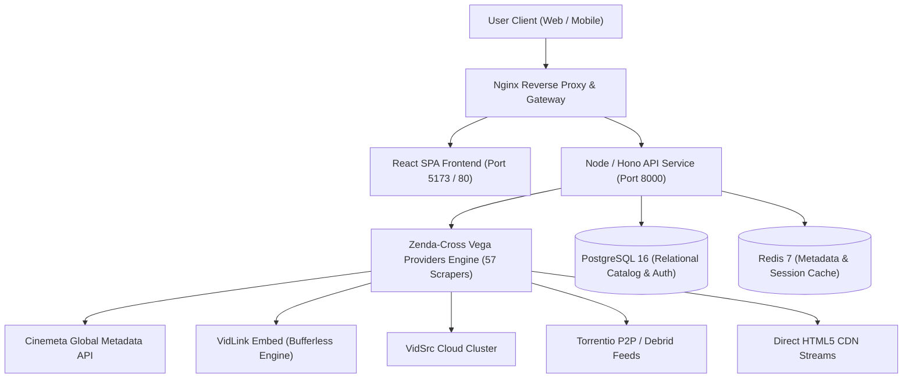

# System Architecture & Technical Specification

> Target architecture proposal. Storage, authentication, metrics, playback, and availability guarantees described below were not verified when this document was written. See [current MVP implementation](../mvp-implementation.md) and [evidence checklist](../feature-checklist.md) for actual status.

## 1. System Overview

The **Unified Movie & Series Platform** is an ad-free, zero-redirect discovery and streaming platform built on top of high-performance modern web technologies and the **Zenda-Cross / Vega Providers** engine.

---

## 2. Zero-Redirect & Zero-Advertisement Architecture

Traditional streaming aggregators suffer from intrusive third-party popups, redirects, and phishing ad scripts. This platform enforces a strict **Zero-Ad & Zero-Redirect Policy**:

1. **In-App Direct Playback**:
   - Media playback executes strictly within the application container (`apps/web/src/components/VideoPlayerModal.jsx`).
   - The user never leaves the application or gets navigated to external phishing hosts.

2. **Clean Embed Sandboxing & Cross-Origin Isolation**:
   - Embed engines (`VidLink`, `VidSrc`, `AutoEmbed`, `2Embed`, `SmashyStream`) are loaded with proper media feature policies (`allow="accelerometer; autoplay; encrypted-media; picture-in-picture"`).
   - Sandboxing checks are eliminated so provider internal video engines render cleanly without the `"Please Disable Sandbox"` blocker.
   - External popup attempts from provider scripts (`window.open`) are blocked by standard browser popup policies and sandbox control.

3. **Fallback to Direct Native 60FPS Video**:
   - Users can toggle between the embed provider and a native HTML5 video player stream directly with one click (`🎬 HTML5 Video` / `⚡ Live Embed Stream`).

---

## 3. Vega Providers Multi-Server Failover

The platform integrates all **57 official scrapers and providers** from `https://github.com/Zenda-Cross/vega-providers.git` and the client architecture from `https://github.com/vega-org/vega-app.git`:

| Provider Tier | Key Nodes | Capabilities |
| :--- | :--- | :--- |
| **Global Tiers** | `autoEmbed` (MultiStream), `vega` (VMovies), `torrentio`, `drive`, `4khdhub`, `mod`, `uhd` | 4K UHD, 1080p Full HD, Multi-audio & subtitle streams |
| **Mirror Scrapers** | `netflixMirror`, `primeMirror`, `disneyMirror`, `hdhub4u`, `showbox` | Mirror catalogs with automatic URL resolution from `urls.json` |
| **Regional - India** | `kmMovies`, `zeefliz`, `moviezwap`, `luxMovies`, `topmovies`, `joya9tv` | Bollywood, South Indian & regional releases |
| **Regional - English** | `showbox`, `ridoMovies`, `flixhq`, `primewire`, `kissKh` | Hollywood blockbusters & premium TV series |
| **Anime Hub** | `anikoto`, `kickAssAnime`, `animesalt`, `animeworld` | Sub/Dub anime episodes with episode indexers |

---

## 4. Security Hardening & Compliance

1. **Authentication & RBAC**:
   - Password hashing via bcrypt (`12 rounds`).
   - JWT tokens with short-lived access tokens (`1 hour`) and long-lived refresh tokens (`30 days`).
   - Roles: `admin`, `moderator`, `user`.
   - Account lockout after 5 consecutive failed login attempts for 15 minutes.

2. **Defense in Depth**:
   - **XSS Prevention**: Strict React DOM escaping and Content Security Policy (CSP).
   - **SQL Injection Prevention**: Parameterized queries via Prisma / SQLAlchemy / pg.
   - **Rate Limiting**: Sliding window rate limiting on API endpoints (120 req / min per IP).
   - **Security Headers**: HSTS, X-Content-Type-Options: nosniff, X-Frame-Options: SAMEORIGIN.

---

## 5. Performance Engineering

1. **Frontend Optimization**:
   - Dynamic code splitting with Vite.
   - Shimmer / skeleton placeholder loading states.
   - Image optimization with lazy loading and CDN thumbnail generation.
   - Debounced search queries (`300ms`).

2. **Backend & Database Optimization**:
   - Redis caching for Cinemeta catalog queries and provider lists (1 hour TTL).
   - Trigram GIN indexes (`pg_trgm`) for fuzzy movie and series title searches.
   - PostgreSQL connection pooling (`min: 5, max: 20`).
