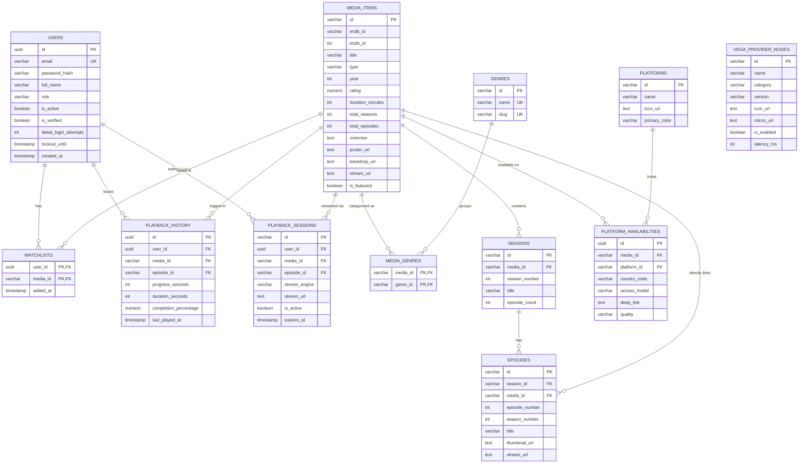

# Database Entity-Relationship (ER) Diagram & Specification

## 1. Mermaid Entity-Relationship Diagram

---

## 2. Table Specifications & Constraints

### `users`
- **Primary Key**: `id` (`UUID`)
- **Unique Constraint**: `email` (`VARCHAR(255)`)
- **Checks**: `role IN ('user', 'admin', 'moderator')`
- **Indexes**: `idx_users_email` (B-Tree), `idx_users_role` (B-Tree)

### `media_items`
- **Primary Key**: `id` (`VARCHAR(100)`)
- **Checks**: `type IN ('movie', 'series', 'anime')`
- **Indexes**:
  - `idx_media_type` (B-Tree)
  - `idx_media_rating` (B-Tree, DESC)
  - `idx_media_imdb` (B-Tree)
  - `idx_media_title_trgm` (GIN trigram index for fuzzy matching)

### `platform_availabilities`
- **Primary Key**: `id` (`UUID`)
- **Foreign Keys**: `media_id` -> `media_items.id`, `platform_id` -> `platforms.id`
- **Unique Constraint**: `(media_id, platform_id, country_code, access_model)`
- **Checks**: `access_model IN ('flatrate', 'free', 'ads', 'rent', 'buy')`

---

## 3. Database Maintenance & Backup Strategy

1. **Automated Daily Backups**:
   - `pg_dump -Fc -U postgres movie_platform > /backups/movie_platform_$(date +%Y%m%d).dump`
   - Retention policy: 30 days daily backups, 12 months monthly snapshots.
2. **Connection Pooling**:
   - Managed via PgBouncer or native application pool (default: 5 minimum, 20 maximum).
