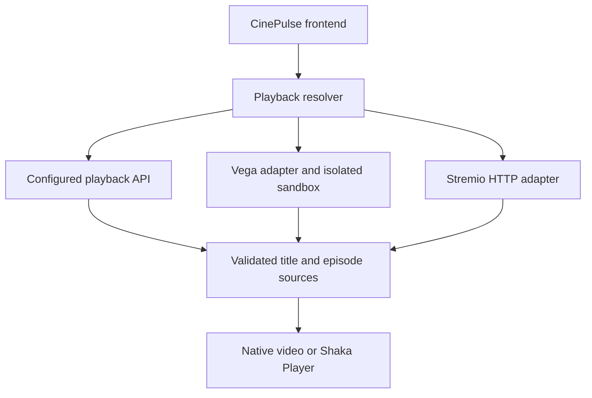

# Provider adapters and adaptive playback

CinePulse preserves the original Vega sandbox and introduces a common adapter boundary for original Vega modules and Stremio HTTP add-ons. It does not import every upstream frontend or server SDK into the browser bundle.



The implementation lives in `apps/web/src/services/providers/contract.d.ts`, `vegaAdapter.js`, `stremioAdapter.js`, and `apps/web/src/services/playbackResolver.js`. Additional providers should implement the shared adapter contract. CinePulse uses `series` for TV titles and normalizes HLS to `m3u8`, DASH to `mpd`, and direct MP4 to `mp4`. Every stream also carries its content ID, selected episode ID, provider, and provenance so playback and resume retain the source identity.

The minimal `search(query)` / `getStreams(mediaId)` example is a useful starting point, but needs these identity fields and episode selection before integration here. Public test streams should remain explicitly labeled demo titles or test fixtures; they must not be returned as replacement sources for unrelated catalog films.

## Using an add-on

Open **Providers → Stremio add-ons**, enter the public HTTPS `manifest.json` URL of a service you trust, and connect it. Choose a catalog, load or search titles when supported, open a title, and select its actual episode before requesting a series stream. Connections persist on this browser/device and can be removed there.

Requests follow the [Stremio HTTP protocol](https://github.com/Stremio/stremio-addon-sdk/blob/master/docs/protocol.md). The service must allow browser access through CORS. Configured manifests must finish service-side configuration first. Catalog, metadata, and stream resources use their declared types and ID prefixes. Series requests use the precise video identity returned by the add-on; CinePulse does not derive a video ID from a title or guessed season number.

The client validates manifests, response shapes, title identity, URLs, and supported media. Catalog results have stable namespaced IDs and duplicate records are removed. Only direct supported media URLs are offered; torrent hashes, external-app links, and streams requiring custom proxy headers are excluded. Failed requests and removed connections produce explicit errors. A discovered URL is not labeled Playing until the media element reports actual playback.

For existing catalog movies, installed add-ons can also resolve a confirmed IMDb ID after the configured playback API returns no source. An explicitly selected add-on title stays bound to that add-on and its title/episode identities. Watch progress preserves those identities for later resume.

## Adaptive playback

Run from the repository root:

```sh
npm run install:player
npm run build:all
```

The web package and lockfile pin **Shaka Player 5.2.12**, so the normal dependency installation includes it. `npm run install:player` also installs missing web dependencies and bundles the runtime. The build verifies the installed version, copies its compiled runtime and full license into the site's own assets, records its SHA-256, and writes `.build/player/build-manifest.json`. Missing installations remove stale runtime assets. Docker builds require Shaka and fail if it is absent. The browser loads this runtime lazily for DASH or HLS when native HLS is unavailable, including `dash`/`hls` format aliases and signed `.mpd`/`.m3u8` URLs labeled `video`. Native MP4/WebM and native HLS keep using the media element. Quality options come from actual Shaka variant tracks; source changes and closing the player destroy its instance.

The source API, source editor, media MIME handling, and SQLite schema now accept DASH (`mpd`). Existing configured source rows are preserved by a transactional migration. Manifest segments must be available from the same configured media service or supported local media routes. No license server, credentials, DRM entitlement, quality ladder, or commercial film is invented.

CI installs the pinned player before audits/checks/builds. The web Docker build installs it with `npm ci` and bundles it too. These installation steps need registry access. The lockfile records the pinned tarball URL; its registry integrity value remains absent because metadata could not be downloaded here. A successful online `npm install` can populate that value; it must not be fabricated.

Run `npm run test:player` for packaging, source-routing, and teardown checks. Run `npm run test:adaptive` after installing Shaka for real decoding checks. That command fails at preflight when Shaka is missing; it does not substitute a fake player or silently skip decoding. Its Playwright checks use locally encoded DASH/WebM and HLS/fMP4 media, check advancing playback time and returned quality tracks, and cover both desktop and mobile Chromium. CI runs it after the regular regression suite. The local report is `.build/e2e/adaptive-results.json`.

## Dependencies and attribution

| Project | Role | License evidence |
| --- | --- | --- |
| [Vega Providers](https://github.com/Zenda-Cross/vega-providers) | Existing vendored original provider modules, executed through the original Vega app sandbox | Local upstream `package.json` declares ISC; no standalone provider LICENSE was found locally. Resolve complete upstream notices before distributing providers. |
| [Stremio Addon SDK](https://github.com/Stremio/stremio-addon-sdk) | Protocol and interface reference; CinePulse implements an HTTP consumer and does not install the SDK's Express/server dependencies | [MIT license](https://github.com/Stremio/stremio-addon-sdk/blob/master/LICENSE.md) |
| [Shaka Player](https://github.com/shaka-project/shaka-player) | Optional installed browser adaptive playback engine | [Apache-2.0 license and included dependency notices](https://github.com/shaka-project/shaka-player/blob/main/LICENSE); build copies the full installed license |

The [Shaka basic usage documentation](https://shaka-project.github.io/shaka-player/docs/api/tutorial-basic-usage.html) supplies the lifecycle used by the integration. The pinned version follows the [5.2.12 release](https://github.com/shaka-project/shaka-player/releases/tag/v5.2.12).

## Validation and limits

Automated checks cover manifest rejection, malformed capabilities, duplicate catalog records, exact series episode requests, safe direct-source selection, decoded native fixture playback, progress identity preservation, and missing-adaptive-engine recovery to another native source. Protocol responses in these tests are explicitly controlled fixtures, not live third-party service verification.

In this session npm could not download Shaka (`EACCES` to the registry), and no cached copy was available. The generated player manifest therefore reports `available: false`. Actual Shaka HLS/DASH decoding, live add-on catalogs, third-party provider availability, and production Docker/HTTPS deployment remain unverified. The app does not replace unavailable commercial titles with public sample clips. Software repositories provide implementation code, not content licenses.

Validation on 2026-10-08:

- Strict frontend lint, API type checking, 22 API tests, complete provider/API/web builds, and database restart/backup/restore checks passed.
- The full desktop/mobile browser regression run passed 47 checks with one intentional duplicate mobile module-integrity check skipped and zero flaky results. Its report is `.build/e2e/full-regression-results.json`.
- After adding the explicit series-episode guard, all eight affected desktop/mobile playback checks passed, including two new guard checks. The follow-up report is `.build/e2e/results.json`.
- Twelve add-on screenshots cover empty, catalog, and episode states at 390×844, 768×1024, 1280×900, and 1600×1000 in `.build/design/addons/`. No horizontal page overflow was found; the new states were visually reviewed. The latest frontend build also passed.
- All 57 Vega providers compile into 285 modules. The original app sandbox used its committed generated snapshot; a fresh upstream source build still requires installing its unavailable dependencies.

Validation on 2026-10-09:

- `npm run check` passed frontend lint, API type checking, all 22 API tests, provider/API/web builds, database backup/restore rehearsal, and 49 desktop/mobile Chromium checks. One duplicate mobile module-integrity check was intentionally skipped.
- `npm run install:player` was retried and failed with registry `EACCES`. Shaka remains unavailable in the generated manifest; adaptive decoding and live remote movie playback remain unverified.

Follow-up installation and routing fixes on 2026-10-09:

- Pinned Shaka in the web dependency files; npm accepted the lockfile with `--package-lock-only --offline`. Registry access still fails with `EACCES` using a workspace cache, and GitHub downloads also fail.
- Player builds now enforce the pinned version and license, clear stale assets after a missing installation, and require the runtime for Docker and dedicated adaptive checks.
- Corrected player routing for generic-format manifest URLs and HLS/DASH aliases. Frontend lint/build, three packaging/lifecycle/routing tests, and the full 49-check desktop/mobile Playwright regression passed; the existing duplicate mobile integrity check remains intentionally skipped.
- Generated local DASH/WebM and HLS/fMP4 fixtures and verified both containers decode and advance beyond one second with Chromium MSE. This is fixture validation, not Shaka verification. `npm run test:adaptive` correctly fails preflight until the actual runtime is installed.
